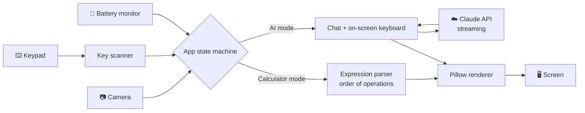

# 🧮 CalcAI — an AI-powered calculator running on a Raspberry Pi

**A real pocket calculator on the outside, a Claude AI assistant on the inside.**

---

## What it does

CalcAI is a Raspberry Pi built into the case of an ordinary calculator. It boots straight into a fully working calculator with a 7-segment display. A key combination switches it into an AI chat with Claude, using the same keypad and a built-in camera.

## Features

**Calculator**
- Correct order of operations, brackets, x², √, %, `Ans` and `DEL`
- 7-segment LCD look with faint "ghost" segments, like a real calculator
- Several colour themes, including a minimalist one

**AI assistant**
- Streaming replies, so text appears word by word
- Choose the Claude model and reasoning effort per chat
- 📷 Photo questions: the camera takes a short burst and sends the sharpest frame
- Multi-layer on-screen keyboard (letters, numbers, symbols, Greek, math symbols) driven by the arrow keys
- Chat history saved on the device

**Device**
- Wi-Fi scan and connect from the device itself
- Battery percentage, low-battery warning and automatic safe shutdown
- Boots straight into the app with a custom splash screen, and restarts itself if anything crashes

## How the AI part works

1. You type a question with the on-screen keyboard, and can attach a photo.
2. The app sends the conversation to the **Claude API** (Anthropic's Python SDK) on a background thread, so the screen never freezes.
3. Photos are resized (max 1536 px), JPEG-encoded and sent alongside the text.
4. The reply **streams** back and is rendered live on the calculator's small screen, with word-wrapping and simple Markdown support.
5. The API key lives in an environment file on the device, never in the code.

## How it works

## Screenshots & photos

| | |
|---|---|
|  |  |
| *Calculator mode* | *AI chat* |
|  |  |
| *Asking about a photo* | *On-screen keyboard* |

<!-- Photos to take:
  hero.jpg             – the finished calculator on a desk
  calculator-mode.jpg  – close-up of the 7-segment display with a calculation
  ai-chat.jpg          – a streamed AI reply on screen
  photo-question.jpg   – camera mode / answer about a photo
  keyboard.jpg         – the on-screen keyboard while typing a question
  (keep the case closed in every photo so no parts are visible)
-->

## Challenges & what I learned

- **Read the pinout twice.** My first screen died because I powered it from 5 V instead of 3.3 V. Now I check every pin against the datasheet before applying power.
- **Designing for a tiny screen.** Fitting a calculator, a chat and a keyboard on a very small display meant writing my own compact layout and text-wrapping code.
- **Keypad ghosting.** Pressing several keys produced phantom presses until I redesigned how the keys are wired.
- **Blurry photos.** Handheld shots were often soft, so the camera now captures a short burst and keeps the sharpest frame, scored with a Laplacian-variance measure.
- **Debugging silent failures.** Photo questions sometimes returned nothing. The cause was the response hitting its token limit, so the app now raises the limit and shows a clear message instead of a blank reply.
- **Linux permissions.** Letting the app manage Wi-Fi without running as root taught me about polkit rules and user groups.
- **Security habits.** The API key is kept out of the code and out of git, and the source lives in a separate private repository. That habit matters given my focus on cybersecurity.
- **Power budgeting.** I measured current draw to estimate about 6 hours of battery life, and added automatic shutdown to protect the battery.

## Source code

The source code is kept private. **It is available on request.** Feel free to reach out.

## About me

I'm Giannis, a 2nd-year Computer, Informatics & Telecommunications Engineering student at the International Hellenic University (Serres), focused on cybersecurity.

